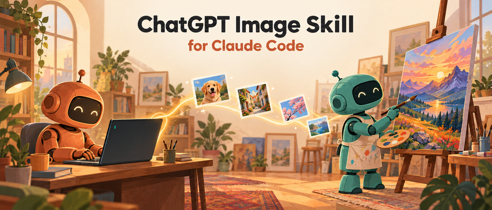

# ChatGPT Image Skill voor Claude Code



Laat Claude Code afbeeldingen maken en bewerken via **Codex**, op je eigen **ChatGPT-abonnement**.
Je betaalt niet per beeld en hebt geen extra sleutels nodig: Claude roept `codex exec` aan, Codex gebruikt
zijn ingebouwde `image_generation` en het resultaat landt als PNG in je project.

Het pakket bevat:

| Onderdeel | Wat het doet |
|---|---|
| **`gptimage`** (skill) | Maakt het beeld. Bevat de wrapper `bin/gpt-image-2`, die Codex aanstuurt. |
| **`gpt-image-prompting`** (skill) | Schrijft op verzoek een sterke Engelse prompt, of meerdere verschillende concepten. |
| **`gpt-image-prompter`** (agent) | Dezelfde prompt-engineering als subagent op Sonnet, handig voor batches. |

```
jouw verzoek ──► (optioneel: prompt-agent schrijft prompt, jij keurt goed)
             ──► gptimage-wrapper ──► codex exec ──► image_generation
             ──► generated-images/<naam>.png ──► Claude bekijkt het resultaat
```

---

## Vereisten

- **Claude Code**
- **Codex CLI**: `brew install codex` of `npm i -g @openai/codex`
- Een **ChatGPT-abonnement waarin Codex beschikbaar is**. In een Team- of Business-workspace moet een beheerder Codex soms eerst aanzetten.
- **Python 3**. Alleen de standaardbibliotheek is nodig, er hoeft niets met pip geïnstalleerd te worden.
- **macOS of Linux**. Op Windows werkt het via WSL. Voor `.jpg`-uitvoer heb je `sips` (macOS) of ImageMagick nodig; `.png` werkt altijd.

## Installeren

Kies **één** van de twee manieren.

### A. Als Claude Code-plugin (aanbevolen)

Typ in Claude Code:

```
/plugin marketplace add Attija/chatgpt-image-skill
/plugin install chatgpt-image@chatgpt-image-skill
```

Start Claude Code daarna opnieuw. Updates haal je later binnen met `/plugin marketplace update chatgpt-image-skill`.

### B. Met het installatiescript

```bash
git clone https://github.com/Attija/chatgpt-image-skill.git
cd chatgpt-image-skill
./install.sh
```

Het script:
- controleert of `python3` en `codex` aanwezig zijn;
- kopieert de twee skills naar `~/.claude/skills/` en de agent naar `~/.claude/agents/`;
- verplaatst een bestaande versie met dezelfde naam eerst naar `~/.claude/backups/chatgpt-image-skill/<tijdstip>/`;
- test of Codex klaar is.

Bijwerken doe je met `git pull && ./install.sh`, verwijderen met `./install.sh --uninstall`.

> Gebruik niet de plugin en het script tegelijk, anders krijg je dubbele skills. Het script waarschuwt als dat zo is.

## Codex koppelen aan je ChatGPT-account

```bash
codex login            # kies "Sign in with ChatGPT"
codex login status     # moet "Logged in using ChatGPT" tonen
```

Controleer daarna de hele keten. Er wordt dan nog geen beeld gemaakt:

```bash
python3 ~/.claude/skills/gptimage/bin/gpt-image-2 --check
# OK (python 3.x; Logged in using ChatGPT)
```

Heb je de plugin-versie, dan staat de wrapper onder `~/.claude/plugins/…/skills/gptimage/bin/`. Je kunt Claude ook gewoon vragen: *"controleer of gptimage werkt"*.

---

## Gebruiken

Praat gewoon met Claude Code, in het Nederlands of Engels.

| Je zegt | Wat er gebeurt |
|---|---|
| *maak een afbeelding: "A red bicycle leaning against a white wall"* | Eén beeld; de tekst tussen quotes gaat letterlijk naar Codex. |
| *gebruik @references/character.png als personage en zet hem in een regenachtige straat in Tokio* | Het bestand gaat echt mee als referentie (Image 1). |
| *maak de paraplu geel* (na het vorige beeld) | Het **laatste resultaat** wordt bewerkt en opgeslagen als `…-v2.png`. |
| *maak vijf verschillende posterontwerpen voor mijn bakkerij* | Vijf aparte concepten, `poster-01.png` t/m `poster-05.png`. |
| *schrijf een goede prompt voor een productfoto van mijn mok* | De prompt-skill of -agent schrijft de prompt; pas na jouw akkoord wordt het beeld gemaakt. |

De beelden komen in `generated-images/` in je project. Die map staat in `.gitignore`.

### De drie werkregels

1. **Jouw prompt is leidend.**
   - Bij één beeld of bewerking gaat je verzoek ongewijzigd naar Codex. Claude voegt geen stijl, licht of details toe die je niet vroeg.
   - Vraag je zelf om creatief werk ("vijf verschillende ontwerpen"), dan maakt Claude per beeld een eigen, echt andere prompt. Het onderwerp, je referenties, je merk, letterlijke tekst en de verhouding blijven in elk ontwerp gelijk.
   - Volgnummers staan alleen in de bestandsnaam, nooit in de prompt.
2. **Referenties zijn bestanden, geen beschrijvingen.**
   - Verwijs met `@pad/naar/beeld.png` of een volledig pad. Toegestaan zijn PNG, JPEG en WebP.
   - Een plaatje dat je in de chat plakt of sleept gaat **niet** vanzelf mee naar Codex. Sla het op in je project, bijvoorbeeld in `references/`, en verwijs ernaar.
   - Ontbreekt een referentie, dan stopt Claude en vraagt om het bestand. Het beeld wordt nooit stiekem "beschreven".
3. **Een revisie bewerkt altijd het laatste resultaat.**
   - Elke aanroep staat op zichzelf. Bij "pas het aan" wordt het vorige beeld de bewerkingsbasis. Referenties gaan alleen opnieuw mee als de wijziging ze nodig heeft.
   - Stuur je bij een bewerking extra referenties mee, zeg dan wat elk beeld doet ("bewerk Image 1, gebruik Image 2 alleen voor het patroon"). Anders kan het model alle beelden naast elkaar zetten.
   - Nieuwe versies krijgen `-v2`, `-v3`. Bestaande bestanden worden nooit stilletjes overschreven.

### De wrapper zelf aanroepen

Meestal doet Claude dit voor je, maar het kan ook handmatig:

```bash
W=~/.claude/skills/gptimage/bin/gpt-image-2
mkdir -p generated-images

# tekst → beeld (liggend)
python3 $W "A red bicycle leaning against a white wall" "$PWD/generated-images/fiets.png" --size 1536x1024

# referentie in de prompt
python3 $W "Use @references/character.png as the character reference and place it in a rainy Tokyo street at night" "$PWD/generated-images/tokyo.png"

# revisie van het laatste resultaat
python3 $W "Make the umbrella yellow. Change nothing else." "$PWD/generated-images/tokyo-v2.png" \
  --edit-target "$PWD/generated-images/tokyo.png" --image "$PWD/references/character.png"
```

| Optie | Betekenis |
|---|---|
| `--edit-target PAD` | Het beeld dat bewerkt wordt; gaat mee als Image 1. |
| `--image PAD` | Extra referentie, mag vaker gebruikt worden. |
| `@pad.png` in de prompt | Gaat mee als referentie en wordt in de prompt `Image N`. |
| `--size BxH` | Alleen een vormhint: vierkant, staand of liggend. Codex kiest de exacte pixels. |
| `--overwrite` | Een bestaand bestand mag vervangen worden. |
| `--orchestrator-model` | `auto` (standaard), `account-default`, of een model-ID dat je zelf kiest. |
| `--timeout SEC` | Standaard 900. |
| `--check` | Controleert alleen python3 en de Codex-login. |

Over `--orchestrator-model`: Codex gebruikt een taalmodel om de beeldtool aan te sturen.
- `auto` laat Codex een actueel model kiezen dat jouw account mag gebruiken, met lage reasoning. Dat is snel genoeg voor deze simpele taak.
- `account-default` laat ook de reasoning aan Codex over.
- Een eigen model-ID pinnen kan, maar is alleen nodig als je daar zelf voor kiest.

Er is geen automatische retry of terugval: een fout van Codex krijg je één keer, letterlijk, te zien.

---

## Welk beeldmodel?

Codex bepaalt zelf welk beeldmodel zijn `image_generation` gebruikt; je kunt het niet kiezen. Op dit moment levert Codex nog beelden van *gpt-image 2.0*, ook al is ChatGPT Images 2.5 aangekondigd. Zodra Codex overstapt, gebruikt deze skill het nieuwe model vanzelf, zonder update.

## Kosten en limieten

Beelden tellen mee voor de gebruikslimieten van je ChatGPT-abonnement. Er komen geen kosten per beeld bij.
Is de limiet bereikt, dan meldt Codex dat; wacht dan tot de limiet is gereset. Elke generatie verschijnt
ook als sessie in je Codex-geschiedenis.

## Problemen oplossen

| Melding | Oplossing |
|---|---|
| `exit 3` / *codex CLI not found* | Installeer Codex (`brew install codex`). |
| `exit 3` / *not logged in with a ChatGPT account* | `codex login` → "Sign in with ChatGPT". |
| `exit 2` / *not found or not readable* | Het referentiebestand bestaat niet of het pad klopt niet. Gebruik een pad binnen je project. |
| `exit 2` / *output already exists* | Kies een nieuwe naam (`-v2`) of geef `--overwrite` mee. |
| *Codex changed the prompt* | Codex heeft je prompt aangepast. Beide versies staan in `<beeld>.revised_prompt.txt`. |
| Codex-model niet beschikbaar in je workspace | Laat `--orchestrator-model` op `auto` staan, of vraag je beheerder Codex aan te zetten. |
| Limiet bereikt | Wacht tot de ChatGPT-limiet is gereset. |
| Resultaat is een collage van alle inputbeelden | Geef elk beeld een rol in de prompt en laat overbodige referenties weg. |
| Verkeerde verhouding bij een bewerking | Met inputbeelden houdt het resultaat meestal de vorm van Image 1 aan; `--size` is alleen een hint. |
| Transparante achtergrond nodig | Dat kan via Codex nu niet. Vraag om een effen achtergrond en stel het beeld daarna vrij. |

## Verwijderen

- Plugin: `/plugin uninstall chatgpt-image`
- Script: `./install.sh --uninstall`. Dat verwijdert alleen wat het script zelf heeft geïnstalleerd; back-ups blijven staan.

## Licentie

MIT, zie [LICENSE](LICENSE).
